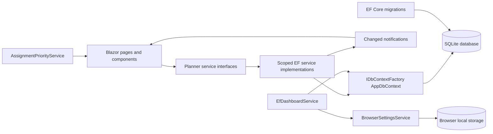

# Backend Architecture

## Runtime shape

The Blazor components continue to depend on the existing `I*Service` contracts. Production registrations point to EF-backed services; the mock services remain in the project for frontend-only and focused unit tests. Settings intentionally remain browser-local.

Each database operation creates and disposes its own `AppDbContext` from `IDbContextFactory<AppDbContext>`. Components and circuit-scoped services do not hold a context. Reads use `AsNoTracking`; writes publish the existing `Changed` notification after commit. Notification-handler failures are logged without reporting a committed write as failed.

The configured SQLite connection enables foreign keys and pooling. The default database path is in the user's LocalApplicationData directory, independent of the shell's current directory. `DatabasePath` creates its parent directory and resolves configured relative paths against that same application directory.

## Service mapping

| Contract | Implementation | Notes |
|---|---|---|
| `ICourseService` | `EfCourseService` | Normalized unique course codes; restricts deletion when academic records exist |
| `IAssignmentService` | `EfAssignmentService` | Persists by `CourseId`; display name is hydrated from the relationship |
| `IGradeService` | `EfGradeService` | Course credits are derived from the related course for calculations |
| `IScheduleService` | `EfScheduleService` | Nullable course; detects overlapping events |
| `IDashboardService` | `EfDashboardService` | Reads counts, deadlines, today's events and weighted GPA from SQLite |
| `ISettingsService` | `BrowserSettingsService` | Preserves the existing browser local-storage contract |

`IAssignmentQueryService` and `IScheduleQueryService` add optional server-side filtering without changing the existing frontend service signatures. The priority service is stateless and pure with respect to its input.

## Migration and startup

`DbInitializer` calls `Database.MigrateAsync`; it never creates or drops a schema outside migrations. The default setting applies pending migrations during startup. Development sample data is seeded in one transaction only when student, course, assignment, grade, and schedule tables are all empty. Production does not seed demo data.

Database settings use:

- `Database:Path` / `Database__Path`
- `Database:ApplyMigrationsOnStartup` / `Database__ApplyMigrationsOnStartup`

## Integration safety

`CourseName`, assignment completion convenience state, grade percentage/credits, and calendar convenience properties are excluded from persistence. Relationships persist through `CourseId`; navigation properties are optional and are not annotated as required. `StudentSettings` is not duplicated in SQLite.
