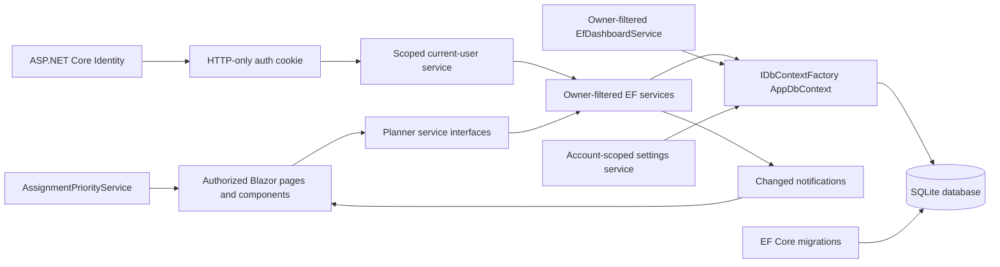

# Backend Architecture

## Runtime shape

The Blazor components continue to depend on the existing `I*Service` contracts. Production registrations point to EF-backed services; mock services remain for frontend-only tests. ASP.NET Core Identity uses the same `AppDbContext` and SQLite database. A scoped `ICurrentUserService` resolves the authenticated principal from the Blazor `AuthenticationStateProvider`; database services apply that server-derived owner ID to every query and mutation. Preferences are stored per account in SQLite.

Each database operation creates and disposes its own `AppDbContext` from `IDbContextFactory<AppDbContext>`. Components and circuit-scoped services do not hold a context. Reads use `AsNoTracking`; writes publish the existing `Changed` notification after commit. Notification-handler failures are logged without reporting a committed write as failed.

The configured SQLite connection enables foreign keys and pooling. The default database path is in the user's LocalApplicationData directory, independent of the shell's current directory. `DatabasePath` creates its parent directory and resolves configured relative paths against that same application directory.

## Service mapping

| Contract | Implementation | Notes |
|---|---|---|
| `ICourseService` | `EfCourseService` | Filters all operations by owner; course codes are unique per account |
| `IAssignmentService` | `EfAssignmentService` | Filters by owner and verifies selected courses belong to that owner |
| `IGradeService` | `EfGradeService` | Filters by owner and verifies the course owner |
| `IScheduleService` | `EfScheduleService` | Filters by owner, checks owner of linked courses, detects owner-local overlaps |
| `IDashboardService` | `EfDashboardService` | Aggregates only the signed-in account's records |
| `ISettingsService` | `IdentitySettingsService` | Persists theme, GPA scale, profile preferences, and notifications per user |

`IAssignmentQueryService` and `IScheduleQueryService` add optional server-side filtering without changing the existing frontend service signatures. The priority service is stateless and pure with respect to its input.

## Migration and startup

`DbInitializer` calls `Database.MigrateAsync`; it never creates or drops a schema outside migrations. The default setting applies pending migrations during startup. Development sample data is seeded in one transaction only when student, course, assignment, grade, and schedule tables are all empty. Production does not seed demo data.

Database settings use:

- `Database:Path` / `Database__Path`
- `Database:ApplyMigrationsOnStartup` / `Database__ApplyMigrationsOnStartup`

## Integration safety

`CourseName`, assignment completion convenience state, grade percentage/credits, and calendar convenience properties are excluded from persistence. Relationships persist through `CourseId`; navigation properties are optional and are not annotated as required. Profile identity lives in Identity; account preferences are persisted separately in `UserPlannerSettings`.

Identity-owned records use nullable `OwnerId` to preserve the old database during migration. Application-created records always receive a server-resolved owner. Unowned legacy rows are excluded from all authenticated service queries. See `AUTHENTICATION_AND_SECURITY.md` for the deliberate legacy-data boundary and authentication flow.

## Focus and planning feature boundaries
The Focus Lab component delegates persistence and account scoping to `IFocusSessionService`; its scoped implementation owns the monotonic stopwatch state and computes durations on the server. Assignment IDs are checked against the current user before session creation. Insights use a separate owner-filtered query service and a pure deterministic workload planner, keeping UI rendering independent of forecasting rules.
