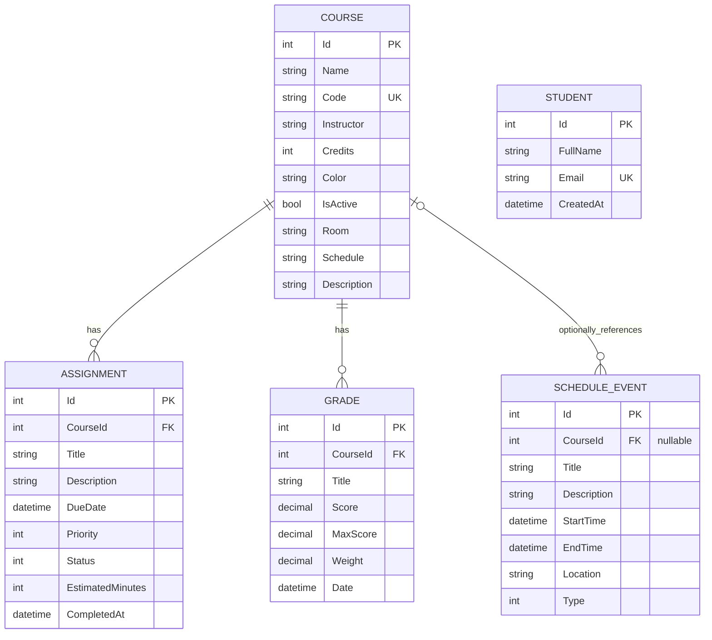

# Database Schema

The initial migration is `InitialCreate`. The SQLite schema is generated from `AppDbContext` and preserves the existing shared model fields.

## Constraints and indexes

- Course code is trimmed, uppercased by the service, and unique with SQLite `NOCASE` collation.
- Assignment and Grade course foreign keys use `RESTRICT`; academic history must be removed or reassigned before course deletion.
- Schedule event course foreign key uses `SET NULL`, preserving event details if its course is deleted.
- Schedule start time and course ID, course activity, assignment status/deadline, assignment course/priority, grade course/date, and student email have indexes.
- Grade decimal properties declare precision for providers that enforce it. SQLite stores decimal values as text and application calculations use the shared decimal `GpaCalculator`.
- Enum values are stored as integers.
- Date/time values preserve the existing local wall-clock `DateTime` contract. A production multi-time-zone deployment should agree on UTC conversion before changing this contract.

`StudentSettings` stays in browser local storage and has no duplicate database table. The `Student` table is available for profile persistence; current settings remain browser-scoped by design.

## Database file

By default the database is `%LOCALAPPDATA%/StudentPlanner/studentplanner.db`. The configured path can be absolute or relative to `%LOCALAPPDATA%/StudentPlanner`. Directory creation is handled by `DatabasePath`. No startup operation drops a database or deletes records.
